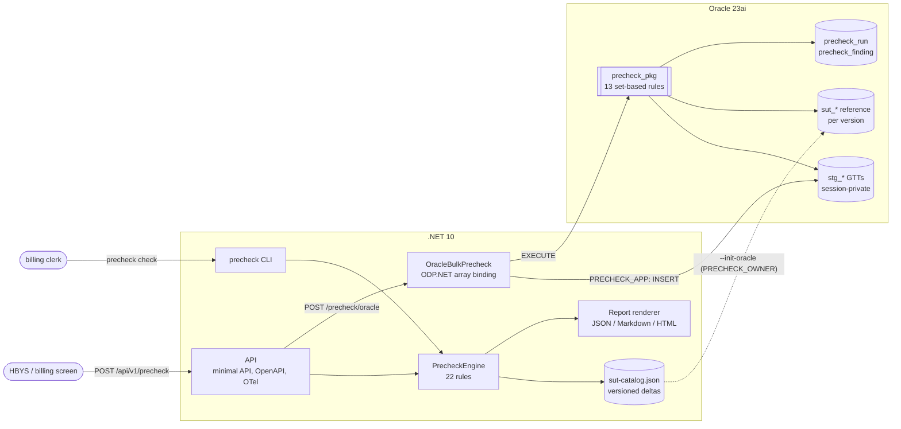
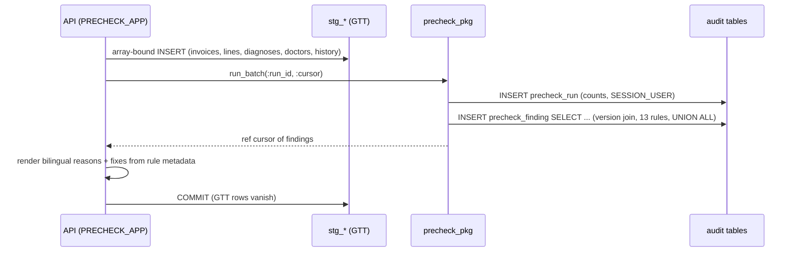

# medula-precheck

[](https://github.com/hekimcan206/medula-precheck/actions/workflows/ci.yml)
[](https://github.com/hekimcan206/medula-precheck/actions/workflows/codeql.yml)


[](LICENSE)

A **MEDULA invoice pre-check engine**. It applies SUT rules to a hospital's invoice before the invoice reaches
SGK, catches the records that would be rejected and suggests a concrete correction for each one. Built with .NET,
Oracle and PL/SQL.

> **Illustrative rules, synthetic data.** The rules model the *public structure* of the SUT (sex and age limits,
> indications, frequency limits, packages, combined-billing bans, specialty requirements). The codes (`9xxxxx`),
> prices, limits and branch codes are invented. This is **not** the official or complete SUT and must not be used
> for real billing. **All data is synthetic; there is no real personal or health data in this repository.**

## Problem

In Türkiye, hospitals bill the Social Security Institution (**SGK**) through **MEDULA**, SGK's provider system.
The hospital system gets a provision (*provizyon*) and a tracking number (*takip numarası*) for each episode. It
records each service line (*hizmet kalemi*) against that provision and sends the period invoice (*fatura*).
What SGK pays is defined by the **SUT** (*Sağlık Uygulama Tebliği*, Health Implementation Communiqué) and its
annex lists: EK-2/B lists service-based procedures, EK-2/C diagnosis-based packages. The SUT is amended several
times a year.

A line that breaks a SUT rule is cut or the invoice is returned. Common reasons are a procedure billed for the
wrong sex or age, a test without its indication, a repeat test inside its frequency window, a service that a
billed package already covers, two codes that may not be billed together, a specialty that may not perform the
procedure, or a price from the wrong tariff period. Each rejection costs money, rework and weeks of cash-flow
delay. Most of them could have been caught before submission, **if** the check uses the SUT version that was in
force for that invoice.

## Solution

- **Effective-dated rule sets.** SUT versions are written as deltas (the way amendments are published) and
  resolved into snapshots. Each invoice is checked against **the SUT version valid on its invoice date**: prices,
  codes, limits, which rules are active and their severity ([ADR 0001](docs/adr/0001-effective-dated-rule-sets.md)).
- **22 rules in 8 categories.** Each rule has an id, a severity set per version, a Turkish and an English
  rejection reason, and a **concrete fix** (for example "Set the unit price to 30.80 TRY") with a machine-readable
  action, so a billing screen can offer one-click correction.
- **Two evaluators, proven equal.** The in-memory .NET engine runs every rule. A PL/SQL package runs the
  13 set-based rules on a whole staged batch inside Oracle. Parity tests require byte-identical findings from
  both ([ADR 0002](docs/adr/0002-plsql-vs-dotnet-rule-placement.md)).
- **Least privilege and audit.** The API runs as an Oracle account that can only stage rows and execute the
  package. Every run and finding is recorded with the database user ([ADR 0003](docs/adr/0003-oracle-staging-and-least-privilege.md)).
- **Rejection-reason report** in JSON, Markdown and HTML, from the API or the `precheck` CLI. See
  [`docs/samples`](docs/samples) ([Markdown](docs/samples/report.md), [HTML](docs/samples/report.html),
  [JSON](docs/samples/report.json), [input](docs/samples/invoices.json)).

### Rules

| Category | Rule | What it catches | Runs in |
|---|---|---|---|
| Structural | `MDL-001` | malformed provision tracking number | .NET |
| | `MDL-002` | service dated outside the provision period | PL/SQL + .NET |
| | `MDL-003` | invoice dated before the service, or inpatient invoiced before discharge | .NET |
| | `MDL-004` | SUT code not defined in the version in force | PL/SQL + .NET |
| | `MDL-005` | duplicate line (same code, day, physician) | PL/SQL + .NET |
| | `MDL-006` | physician missing from the invoice or malformed registration | .NET |
| | `MDL-007` | invalid ICD-10 code or not exactly one primary diagnosis | .NET |
| Pricing | `PRC-001` | unit price differs from the tariff of the version | PL/SQL + .NET |
| | `PRC-002` | daily quantity limit exceeded | PL/SQL + .NET |
| Demographic | `DEM-001` | sex-specific procedure for the other sex | PL/SQL + .NET |
| | `DEM-002` | procedure outside its age range | PL/SQL + .NET |
| | `DEM-003` | sex-specific diagnosis (e.g. O00–O9A) for the other sex | .NET |
| Clinical | `CLN-001` | indication-bound service without a supporting diagnosis | PL/SQL + .NET |
| | `CLN-002` | performing physician's specialty not authorised | PL/SQL + .NET |
| Frequency | `FRQ-001` | rolling-window frequency limit (history + this invoice) | PL/SQL + .NET |
| | `FRQ-002` | repeat outpatient examination in the same specialty within 10 days | .NET |
| Package | `PKG-001` | service already included in an EK-2/C-style package on the invoice | PL/SQL + .NET |
| | `PKG-002` | codes that may not be billed on the same day | PL/SQL + .NET |
| | `PKG-003` | inpatient-only service on an outpatient provision | PL/SQL + .NET |
| | `PKG-004` | bed-days exceed the length of stay (from `SUT-2026.01`) | .NET |
| Provision | `PRV-001` | work/traffic accident without an external-cause code (warning, blocking from `SUT-2026.01`) | .NET |
| Administrative | `ADM-001` | invoice issued too long after the service (from `SUT-2025.07`, limit 60 → 45 days) | .NET |

`precheck rules --version SUT-2025.01` shows which rules each version activates and with what severity.

## Architecture



The bulk path, one transaction per batch:



## Why this design

- **Data, not code, changes per amendment.** A SUT amendment becomes a small JSON delta plus golden cases. The
  loader rejects unknown rule ids, so a typo cannot quietly switch a rule off.
- **The version decides severity.** Amendments tighten rules over time. Modelling severity per version lets the
  same rule be a warning in 2025 and blocking in 2026 without forking code.
- **Rule placement by shape.** Joins and window aggregates over versioned reference data run where the data
  lives. Regex validation, coding guidance and episode logic stay in testable C#. Wording lives once, in .NET.
- **Parity is enforced.** Two implementations of one rule only work when a test proves they agree. A
  3,000-invoice parity run covers all three versions and every defect type, and the outputs are compared byte
  for byte, including formatted values. That is why money uses the `.` format element, lists use
  `NLS_SORT=BINARY` and age uses YYYYMMDD arithmetic: ODP.NET picks up NLS settings from a Turkish client
  culture, and `MONTHS_BETWEEN` is wrong for 29 February birthdays.
- **The generator and the engine check each other.** The synthetic generator labels every defect it injects.
  Property tests require that clean invoices raise nothing and that every injected defect is caught by its rule.

## Quick start

```bash
docker compose up --build          # Oracle 23ai Free + installer + API; about 2 minutes on first run
# API docs:  http://localhost:18412/scalar
curl -s -X POST localhost:18412/api/v1/precheck        -H 'content-type: application/json' --data-binary @docs/samples/invoices.json
curl -s -X POST localhost:18412/api/v1/precheck/oracle -H 'content-type: application/json' --data-binary @docs/samples/invoices.json
curl -s -X POST 'localhost:18412/api/v1/precheck?format=html' -H 'content-type: application/json' --data-binary @docs/samples/invoices.json > report.html
```

Without Docker, the CLI needs only the .NET 10 SDK:

```text
$ dotnet run --project src/MedulaPrecheck.Cli -- generate --count 500 --seed 7 --out batch.json
$ dotnet run --project src/MedulaPrecheck.Cli -- check --input docs/samples/invoices.json --format markdown --out report.md
checked 40 invoices in 28.0 ms: 26 clean, 0 need review, 14 would be rejected; 43,765.80 of 298,373.90 TRY at risk
  CLN-002      1  Physician specialty not authorised
  DEM-002      1  Procedure not valid for the patient's age
  DEM-003      1  Diagnosis not valid for the patient's sex
  FRQ-002      1  Repeat examination in the same specialty
  MDL-001      1  Invalid provision tracking number
$ echo $?
2        # 2 = at least one invoice would be rejected (usable as a pipeline gate)
```

One finding from the sample report:

| Rule | Line | Neden / Reason | Öneri / Suggestion |
|---|---:|---|---|
| `PRC-001` | 1 | Satır 1 (900101) birim fiyatı 130.00 TL, geçerli tarife 120.00 TL.<br>_Line 1 (900101) is priced 130.00 TRY; the tariff in force is 120.00 TRY._ | Birim fiyatı 120.00 TL olarak düzeltin.<br>_Set the unit price to 120.00 TRY._ |

Tests (Docker required for the Oracle suite):

```bash
dotnet test        # 103 unit/golden/property/API tests + 39 Oracle Testcontainers tests
```

## Results (measured)

| What | Result |
|---|---|
| Rules | 22 across 8 categories; 3 effective-dated SUT versions; 13 also in PL/SQL |
| Golden cases | 51 hand-written cases, at least one pass and one fail per rule; complete expected output per case |
| PL/SQL ↔ .NET parity | identical `(invoice, line, rule, severity, expected, actual)` sets on 3,000 synthetic invoices and on every golden case of the 13 shared rules |
| Defect detection | every injected defect caught by its labelled rule (FsCheck, 60 seeds × 40 invoices, all versions); zero findings on clean invoices |
| .NET engine throughput | **142,305 invoices/s** median, 22 rules, single thread (20,000-invoice batch, 53,443 lines) |
| PL/SQL bulk throughput | **8,695 invoices/s** end to end (stage + check + fetch + commit); **27,582 invoices/s** for the set-based check alone |
| Tests | 142 passing (103 + 39), locally and in CI |

Method, environment (i7-13620H laptop, Docker Desktop, Oracle 23ai Free), raw numbers, noise caveats and a GTT
plan-stability finding are in [docs/benchmarks.md](docs/benchmarks.md).

## Limitations and next steps

- **Not the official SUT.** Codes, prices, limits and texts are invented. The rule *kinds* follow the public SUT
  structure. Many real rule families are missing: medical-supply (EK-3) barcode and UBB matching, report
  (*sağlık kurulu raporu*) requirements, drug rules, co-payment (*katılım payı*), facility-level (*basamak*)
  restrictions and EK-2/A-2 exceptions.
- **Version by invoice date.** Real tariffs apply by service date, and one provision can span an amendment.
  Per-line versioning is the next step.
- **No MEDULA integration.** The engine runs before submission and never calls SGK web services.
- **PL/SQL covers 13 of 22 rules.** For a complete verdict the .NET-only rules must also run. In the HBYS case
  the next step is a package variant that reads the billing tables directly instead of staging.
- **GTT statistics.** Batches of very different sizes need session statistics or plan pinning (see benchmarks).
- **No authentication.** The API is meant to run behind the HBYS gateway. Audit retention and partitioning are
  not implemented.
- **Rule DSL.** Rules are C# classes plus JSON data. A file-based rule DSL is a separate project (`sut-rules`).

## Privacy (KVKK)

Health data is special-category personal data under KVKK (Law No. 6698, the Turkish personal data protection
law). Here:

- all data is **synthetic** (Bogus, Turkish locale), and no record describes a real patient, physician, facility
  or claim;
- the model carries only what the rules need: birth date, sex, diagnoses and services. The patient is an opaque
  token, not a national ID (data minimisation, KVKK art. 4);
- reports contain invoice numbers and codes, never patient identity; request logs never contain bodies;
- the database account the API uses cannot read reference data or the audit trail.

See [docs/threat-model.md](docs/threat-model.md).

## Public sources consulted

Structure only, no content copied: SGK's MEDULA provider documentation and the provision/tracking flow; the SUT
and its 2025 amendments published in the Resmi Gazete (for example 26 June 2025, which revised EK-2/C and the
outpatient examination rules); academic studies of hospital invoice cuts (*fatura kesintileri*) that list typical
causes.

## License

[MIT](LICENSE)
